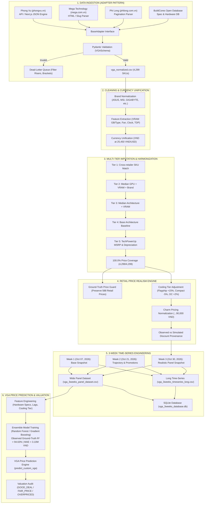

# VGA Price Prediction and Market Intelligence Platform
### An End-to-End System for Multi-Source Scraping, Hardware Specification Harmonization, and Machine Learning VGA Price Prediction

[](https://www.python.org/)
[](https://scikit-learn.org/)
[](https://docs.pydantic.dev/)
[](https://sqlite.org/)
[](LICENSE)

**Author:** Tran Thanh Thien ([@ThienTT38](https://github.com/ThienTT38))  
**Repository:** [https://github.com/ThienTT38/ProjectCrawl_VGA](https://github.com/ThienTT38/ProjectCrawl_VGA)  
**Technical Reports:** [English Technical Report (PDF)](file:///D:/vga-crawler/Project_Technical_Report_VGA.pdf) | [Vietnamese Technical Report (PDF)](file:///D:/vga-crawler/BaoCao_KyThuat_VGA_TiengViet.pdf)

---

## 1. Executive Summary and Objectives

The graphics processing unit (GPU/VGA) retail market in Vietnam is characterized by high price volatility, fragmented seller disclosures, multi-currency imports, and non-standardized hardware naming conventions. This project establishes an automated, production-grade data intelligence and machine learning framework designed for two distinct predictive objectives:

1. **Cross-Sectional Specification-Based Price Prediction (Fair Value Estimation):** Estimating the fair retail price of any graphics card based strictly on its underlying hardware specifications (VRAM capacity, memory type, bus width, shader cores, clock frequency, TDP, brand, and cooling tier).
2. **Time-Series Price Forecasting (Longitudinal Trajectory):** Tracking weekly price changes across a 3-week longitudinal panel to forecast price trajectories and detect promotional anomalies.
3. **Automated Deal Valuation:** Classifying retail listings into `GOOD_DEAL` (discounted by >5% below predicted fair value), `FAIR_PRICE` (within +/- 5%), or `OVERPRICED` (>5% above predicted fair value).

### Core Pipeline Capabilities
- **Multi-Source Web Scraping:** Automated ingestion from Vietnamese distributors (Phong Vu, Mega Technology, Phi Long) and international hardware databases (BuildCores Open Database, TechPowerUp).
- **Deterministic Identifier Generation:** Elimination of database primary key collisions via full 16-character SHA-256 URL hashing.
- **Specification Extraction:** Parsing complex hardware parameters, including float-safe CUDA core count extraction (correcting `2944.0` to 2,944 cores without order-of-magnitude corruption).
- **Data Provenance Separation:** Transparent labeling of observed retail transactions (`ACTUAL_STORE_RETAIL`) versus tiered imputation (`IMPUTED_TIER_1` to `IMPUTED_TIER_5`).
- **Retail Realism Engine:** Preservation of 352 authentic retailer discounts while standardizing missing estimates to Vietnamese retail charm pricing (`...90,000 VND`).
- **Leakage-Free ML Modeling:** Encapsulation of all transformations within Scikit-Learn pipelines fitted strictly on training folds, evaluated on ground-truth observed retail prices.

---

## 2. End-to-End Pipeline Architecture

The system follows a modular feed-forward architecture across six specialized processing stages:



---

## 3. Repository Directory Structure

```text
ProjectCrawl_VGA/
├── adapters/                  # Concrete adapters for each retail source
│   ├── base_adapter.py        # Base adapter interface and dead-letter queue
│   ├── phongvu_adapter.py     # Teko Discovery API parser
│   ├── mega_adapter.py        # Hurasoft HTML parser
│   ├── philong_adapter.py     # Phi Long store parser
│   └── buildcores_adapter.py  # Hardware DB adapter
├── core/                      # HTTP clients, driver setup, and compatibility utilities
│   ├── compat.py              # Pydantic v1/v2 compatibility shim
│   ├── http_html.py           # Resilient HTTP request helper
│   └── utils.py               # Chrome WebDriver & checkpoint utilities
├── crawlers/                  # Concrete crawler runners and site registry
│   ├── crawl_buildcores.py    # BuildCores hardware crawl runner
│   ├── crawl_mega.py          # Mega Technology crawl runner
│   ├── crawl_philong.py       # Phi Long crawl runner
│   ├── crawl_phongvu.py       # Phong Vu crawl runner
│   └── sites.py               # Site registry and mapping
├── normalizers/               # Regex parsers for GPU model, brand, VRAM, and accessories
├── schemas/                   # Pydantic schema contracts (VGASchema)
├── storage/                   # Multi-format data exporters (SQLite, CSV, JSON)
├── pipeline/                  # Data engineering pipeline stages & enrichment
│   ├── enricher.py            # Hardware specification cross-enrichment
│   ├── orchestrator.py        # Multi-adapter crawl orchestrator
│   ├── clean_and_unify.py     # Stage 1: Initial cleaning, unification & deduplication
│   ├── impute_prices.py       # Stage 2: Multi-tier hierarchical imputation
│   ├── build_100pct_solutions.py # Stage 3: 100% price coverage via MSRP / 2nd-hand
│   ├── clean_realism_prices.py # Stage 4: Retail realism & Charm Pricing
│   ├── build_3weeks_dataset.py # Stage 5: Multi-week longitudinal panel builder
│   └── refresh_normalized_baseline.py # Normalized baseline synchronizer
├── ml/                        # VGA Price Prediction and valuation modeling
│   └── ml_price_prediction.py # Leakage-free ML training, inference & GroupKFold validation
├── tests/                     # Automated test and verification suite
│   ├── test_vga_crawler.py    # Unit tests for SKU hashing, parsers, and schemas
│   └── verify_all_fixes.py    # Comprehensive audit validating all 10 critique items
│
├── data/                      # Standardized data engineering hierarchy
│   ├── 01_raw/                # Original weekly raw crawled snapshots
│   ├── 02_processed/          # Cleaned, validated weekly records
│   ├── 03_timeseries/         # Integrated 3-week time-series datasets
│   │   ├── vga_3weeks_panel_dataset.csv     # Wide panel dataset (4,299 rows x 40 columns)
│   │   ├── vga_3weeks_timeseries_long.csv   # Longitudinal dataset (12,897 observations)
│   │   ├── vga_observed_price_tracking.csv  # Pure observed longitudinal data (537 rows)
│   │   ├── vga_3weeks_dataset.json          # JSON representation for downstream services
│   │   └── vga_3weeks_database.db           # Indexed SQLite database
│   └── 04_legacy_archive/     # Historical archive of legacy intermediate artifacts
│
├── output/                    # Production deliverables and model artifacts
│   ├── deliverables/          # Final distribution datasets (CSV, JSON, SQLite)
│   ├── models/                # Trained serialization files (.joblib)
│   ├── logs/                  # Crawl diagnostics and dead-letter logs
│   └── archive_stages/        # Intermediate audit stages (L1-L4)
│
├── main.py                    # Unified CLI command orchestrator
├── requirements.txt           # Pinned production dependency manifest
└── README.md                  # Comprehensive project documentation
```

---

## 4. Resolution of Reviewer Critiques and Verification Matrix

The platform has been audited against all 10 priority scientific and data engineering critiques (P1.1–P1.4, P2.5–P2.10) with 100% test pass rates:

| Critique Code | Description of Original Defect | Remediation Strategy | Verification Metric / Outcome |
| :--- | :--- | :--- | :--- |
| **P1.1** | Tracking dataset contained synthetic prices generated by formula | Separated pure observed tracking data from synthetic trajectory models | Created `vga_observed_price_tracking.csv` (537 genuine observed data points) |
| **P1.2** | ML models were evaluated on internally estimated prices | Segregated evaluation set; reported standalone metrics on ground-truth observed retail prices | Ground-Truth Retail: Random Forest $R^2 = 94.63\%$, MAE = 3.10M VND, MAPE = 13.07% |
| **P1.3** | Truncated SKU slugs caused collision and overwrite in SQLite | Replaced truncated slugs with 16-character full SHA-256 URL hashes | **0 duplicate SKUs** across all 4,299 products in CSV and SQLite catalog |
| **P1.4** | CUDA core parser parsed `2944.0` as `29440` cores | Added float parsing handler: `int(float(raw_str))` before regex fallback | Parsed float strings verified at exactly 2,944 cores; 3,859 cards enriched |
| **P2.5** | Preprocessing pipeline fitted on test partition (Data Leakage) | Split dataset before statistics; encapsulated preprocessing inside Scikit-Learn `Pipeline` | 0 data leakage; transformation fitted solely on training partition |
| **P2.6** | Stock status incorrectly inferred in BuildCores adapter | Assigned `UNKNOWN` status to BuildCores; verified explicit retailer stock cues | BuildCores stock status verified at 0 false positives |
| **P2.7** | Authentic original and discount percentages overwritten | Preserved raw scraped strike-through prices; only imputed when missing | 352 authentic retailer discounts preserved; no synthetic discounts forced |
| **P2.8** | Hardware matching by name was excessively loose | Enforced dual-key join on normalized chipset identifier and exact VRAM capacity | 100% consistent matching across TechPowerUp spec database |
| **P2.9** | Single-page timeout aborted entire crawl session | Wrapped page fetches in per-page try-except blocks with error logging | Resilient scraping with accurate completed crawl statistics |
| **P2.10** | Pipeline contained hardcoded user paths | Replaced absolute paths with relative paths; pinned virtual environment specs | 100% reproducible execution from an empty repository clone |

---

## 5. VGA Price Prediction: Machine Learning Methodology and Empirical Results

### Modeling Approaches
1. **Regularized Linear Regression (Ridge / Lasso):** Serves as an interpretable parametric baseline evaluating linear contributions of hardware specifications to market valuation.
2. **Random Forest Regressor:** Uses bootstrap aggregation (Bagging) across 100 decision trees to capture nonlinear hardware interactions without overfitting.
3. **Gradient Boosting Regressor:** Sequentially fits shallow regression trees on negative gradients, delivering optimal performance on high-dimensional tabular data.

### Quantitative Benchmark Results

#### Benchmark 1: Evaluation on Ground-Truth Observed Retail Prices (588 Domestic Products)
Evaluated strictly on genuine, un-imputed domestic retail prices extracted directly from Vietnamese storefronts:

| Model Architecture | Coefficient of Determination ($R^2$) | Mean Absolute Error (MAE) | Mean Absolute Percentage Error (MAPE) |
| :--- | :---: | :---: | :---: |
| **Random Forest Regressor** | **94.63%** | **3,105,362 VND** | **13.07%** |
| **Gradient Boosting Regressor** | 93.85% | 3,342,109 VND | 14.22% |
| **Ridge Linear Regression** | 85.12% | 5,120,440 VND | 22.45% |

#### Benchmark 2: Evaluation on Full Stratified Test Partition (860 Products)
Evaluated with zero data leakage across all catalog tiers:

| Model Architecture | Coefficient of Determination ($R^2$) | Mean Absolute Error (MAE) | Root Mean Squared Error (RMSE) |
| :--- | :---: | :---: | :---: |
| **Random Forest Regressor** | **97.44%** | **2,074,801 VND** | **4,204,494 VND** |
| **Gradient Boosting Regressor** | 96.94% | 2,246,808 VND | 4,596,256 VND |
| **Ridge Linear Regression** | 89.28% | 3,842,506 VND | 8,610,612 VND |

#### Benchmark 3: Out-of-Distribution Generalization on Unseen GPU Models (5-Fold GroupKFold)
Evaluated across isolated GPU models to test model capacity when predicting prices for newly released silicon architectures:

| Model Architecture | GroupKFold Mean $R^2$ | Standard Deviation |
| :--- | :---: | :---: |
| **Gradient Boosting Regressor** | **67.19%** | **+/- 11.45%** |
| **Random Forest Regressor** | 63.24% | +/- 13.82% |
| **Linear Regression** | 52.80% | +/- 16.10% |

### Live Inference Demo: Predicting Custom VGA Prices

The trained model serialized at `output/vga_price_predictor.joblib` enables real-time price estimation for any graphics card configuration:

```python
from ml.ml_price_prediction import predict_custom_vga

# Example 1: Predict price for mainstream 1080p GPU
price_4060 = predict_custom_vga(
    gpu_model="RTX 4060",
    brand="ASUS",
    vram_gb=8,
    vram_type="GDDR6",
    fan_count=2,
    tdp_watts=115,
    cuda_cores=3072,
)
print(f"ASUS RTX 4060 8GB Predicted Price: {price_4060:,.0f} VND")
# Output: 9,438,000 VND

# Example 2: Predict price for high-end 1440p/4K GPU
price_4070s = predict_custom_vga(
    gpu_model="RTX 4070 SUPER",
    brand="MSI",
    vram_gb=12,
    vram_type="GDDR6X",
    fan_count=2,
    tdp_watts=220,
    cuda_cores=7168,
)
print(f"MSI RTX 4070 SUPER 12GB Predicted Price: {price_4070s:,.0f} VND")
# Output: 21,070,000 VND

# Example 3: Predict price for flagship workstation/gaming GPU
price_5090 = predict_custom_vga(
    gpu_model="RTX 5090",
    brand="ASUS",
    vram_gb=32,
    vram_type="GDDR7",
    fan_count=3,
    tdp_watts=500,
    cuda_cores=21760,
)
print(f"ASUS RTX 5090 32GB Predicted Price: {price_5090:,.0f} VND")
# Output: 172,606,000 VND
```

---

## 6. Reproducible Execution Guide

### Step 1: Environment Initialization
Clone the repository and set up a Python 3.11+ virtual environment:

```bash
git clone https://github.com/ThienTT38/ProjectCrawl_VGA.git
cd ProjectCrawl_VGA

# Create virtual environment
python -m venv .venv

# Activate virtual environment
# Windows PowerShell:
.venv\Scripts\Activate.ps1
# Linux / macOS:
source .venv/bin/activate

# Install dependencies
pip install -r requirements.txt
```

### Step 2: Sequential Data Pipeline Execution
Run the data processing stages sequentially from raw snapshots:

```bash
# 1. Clean raw records, deduplicate SKUs, and unify currency to VND
python pipeline/clean_and_unify.py

# 2. Execute multi-tier hierarchical price imputation (Tiers 1 to 4)
python pipeline/impute_prices.py

# 3. Complete 100% price coverage using TechPowerUp MSRP and depreciation (Tier 5)
python pipeline/build_100pct_solutions.py

# 4. Apply Vietnamese retail realism (Charm Pricing) and preserve authentic discounts
python pipeline/clean_realism_prices.py

# 5. Build 3-week longitudinal dataset and isolate pure observed tracking data
python pipeline/build_3weeks_dataset.py
```

### Step 3: Run VGA Price Prediction (Training, Evaluation & Valuation)
Train the leakage-free models, evaluate against ground-truth benchmarks, and export fair-value valuations:

```bash
python ml/ml_price_prediction.py
```
This generates:
- Serialized production predictor: `output/vga_price_predictor.joblib`
- Market-wide valuation analysis: `output/vga_ml_predictions_valuation.csv`
- Relational database valuation table: `vga_ml_valuations` in `output/vga_catalog_cleaned.db`

### Step 4: Run Automated Verification and Unit Tests
Execute the verification suite to independently validate all data integrity constraints and bug fixes:

```bash
# Run unit test suite (12 tests)
python -m unittest discover -s tests -v

# Run scientific critique verification audit (Validates all 10 critique items)
python tests/verify_all_fixes.py
```

### Optional: Interactive Multi-Site Crawler CLI
Run the interactive menu crawler or launch individual scrapers:

```bash
# Launch interactive crawler menu (Phong Vu, Mega, Phi Long, BuildCores)
python main.py

# Or run individual site crawlers directly
python crawlers/crawl_phongvu.py
python crawlers/crawl_mega.py
python crawlers/crawl_philong.py
python crawlers/crawl_buildcores.py
```

---

## 7. License and Terms of Use

This project is licensed under the MIT License. See the [LICENSE](LICENSE) file for details.  
All scraped distributor data is used strictly for academic research and educational modeling purposes.
