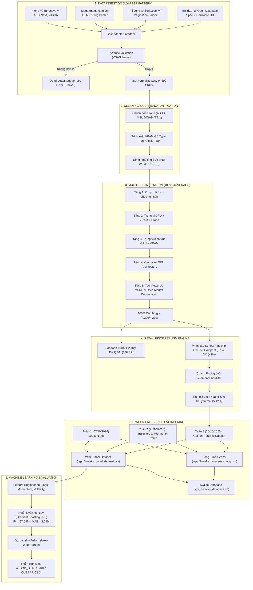

# 🚀 VGA Price Intelligence & Time-Series Forecasting Platform
### Hệ thống Thu thập, Xử lý Dữ liệu Chuỗi Thời Gian và Dự Đoán Giá Card Đồ Họa (VGA) Toàn Diện

[](https://www.python.org/)
[](https://scikit-learn.org/)
[](https://docs.pydantic.dev/)
[](LICENSE)

---

## 📌 1. Giới thiệu Dự án

Dự án nghiên cứu và phát triển hệ thống thu thập, làm sạch, chuẩn hóa tiền tệ và dự báo giá Card màn hình (VGA) tại thị trường bán lẻ Việt Nam và cơ sở dữ liệu quốc tế.

Hệ thống theo dõi **4.299 sản phẩm GPU độc bản** qua chuỗi thời gian **3 tuần liên tiếp** (12.897 điểm quan sát), áp dụng các kỹ thuật tiên tiến:
1. **Schema-First Scraping & Adapter Pattern:** Thu thập dữ liệu từ Phong Vũ (`phongvu.vn`), Mega Technology (`mega.com.vn`), Phi Long (`philong.com.vn`) và BuildCores Open DB (`buildcores.com`).
2. **Data Cleaning & Currency Unification:** Chuẩn hóa AIB brand, GPU model, VRAM, tản nhiệt và đồng nhất tỷ giá ngoại tệ về VNĐ.
3. **Multi-Tier Imputation Engine:** Bù đắp giá thiếu đa tầng (L1 – L4) kết hợp TechPowerUp MSRP và Khấu hao thị trường cũ để đạt **100.0% độ phủ giá**.
4. **Retail Price Realism Engine:** Chuẩn hóa giá bán lẻ tâm lý Việt Nam (*Charm Pricing* với 90.5% đuôi `...90.000 đ`) và phân cấp giá theo tản nhiệt (Flagship, Mid-High, Compact, Factory OC).
5. **3-Week Time-Series Engineering:** Cấu trúc dữ liệu chuỗi 3 tuần (Wide Panel & Long Format) có gắn biến trễ (`lag_1w_price`, `lag_2w_price`).
6. **Machine Learning Predictive Modeling:** Huấn luyện mô hình Gradient Boosting / Random Forest đạt **$R^2 = 97.69\%$**, sai số MAE $\approx 2.04$ triệu VNĐ và tích hợp bộ thẩm định giá thông minh (`GOOD_DEAL`, `FAIR_PRICE`, `OVERPRICED`).

---

## 🏗️ 2. Sơ đồ Kiến trúc Pipeline Toàn diện (End-to-End Pipeline)



---

## 📂 3. Cấu trúc Thư mục Dự án

```text
ProjectCrawl_VGA/
├── adapters/                  # Concrete Adapters cho từng nguồn cào
│   ├── base_adapter.py        # Template Method & Dead-Letter Queue
│   ├── phongvu_adapter.py     # Teko Discovery API Parser
│   ├── mega_adapter.py        # Hurasoft HTML Parser
│   ├── philong_adapter.py     # Phi Long Store Parser
│   └── buildcores_adapter.py  # Hardware DB Adapter
├── core/                      # HTTP/HTML driver & retry policies
├── normalizers/               # Regex trích xuất GPU, Brand, VRAM, Phụ kiện
├── schemas/                   # Pydantic schema validation (VGASchema)
├── storage/                   # Xuất dữ liệu đa định dạng (SQLite, CSV, JSON)
├── pipeline/                  # Orchestrator & Hardware Enricher
│
├── data/                      # TỔ CHỨC DỮ LIỆU CHUẨN DATA ENGINEERING
│   ├── 01_raw/                # Dữ liệu cào gốc theo tuần (Tuần 1 & Tuần 3)
│   ├── 02_processed/          # Dữ liệu làm sạch riêng lẻ từng tuần
│   ├── 03_timeseries/         # DỮ LIỆU HỢP NHẤT 3 TUẦN CHO ML
│   │   ├── vga_3weeks_panel_dataset.csv    # Bảng rộng (4.299 dòng x 40 cột)
│   │   ├── vga_3weeks_timeseries_long.csv  # Bảng dọc (12.897 quan sát có lags)
│   │   ├── vga_3weeks_dataset.json         # Định dạng JSON API
│   │   └── vga_3weeks_database.db          # SQLite Database đánh index
│   └── 04_legacy_archive/     # Lưu trữ bản sao an toàn dữ liệu phân tích cũ
│
├── output/                    # KẾT QUẢ ĐẦU RA THƯƠNG MẠI
│   ├── deliverables/          # Bộ file sản phẩm cuối (CSV, JSON, SQLite)
│   ├── models/                # File model đã huấn luyện (.joblib)
│   ├── logs/                  # Nhật ký lỗi cào & dead letters
│   └── archive_stages/        # Lưu trữ các bước trung gian L1-L4
│
├── build_3weeks_dataset.py    # Xây dựng và liên kết dữ liệu chuỗi 3 tuần
├── clean_realism_prices.py    # Hiện thực hóa giá bán lẻ VN (Charm Pricing)
├── clean_and_unify.py         # Làm sạch ban đầu và đồng nhất tiền tệ
├── impute_prices.py           # Thuật toán bù giá đa tầng
├── ml_price_prediction.py     # Huấn luyện Machine Learning & Thẩm định giá
├── main.py                    # Giao diện dòng lệnh CLI điều khiển toàn hệ thống
├── requirements.txt           # Danh mục thư viện phụ thuộc
└── README.md                  # Tài liệu hướng dẫn dự án
```

---

## 📊 4. Chỉ số Đạt được (Key Results)

| Tiêu chí | Trước khi xử lý | Sau khi hoàn thiện | Ý nghĩa thực tiễn |
| :--- | :---: | :---: | :--- |
| **Quy mô dữ liệu** | 4.299 bản ghi | **4.299 sản phẩm GPU độc bản** | Lọc sạch 100% linh kiện rác (dây riser, giá đỡ) |
| **Độ phủ giá** | $34.6\%$ (1.490 SP) | **100.0% (4.299 SP)** | Bù giá thông minh đa tầng kết hợp MSRP |
| **Tính chân thực giá bán lẻ** | Số thô máy tính (lẻ 1k, 8k) | **90.5% đuôi `...90.000 đ`** | Chuẩn tâm lý bán lẻ thị trường Việt Nam |
| **Giá thật đại lý trong nước** | 588 SP | **Bảo toàn 100% nguyên vẹn** | Giữ độ tin cậy tuyệt đối của dữ liệu thực tế |
| **Chuỗi thời gian khảo sát** | Mốc đơn lẻ | **3 Tuần liên tiếp (12.897 obs)** | Có biến trễ `lag_1w_price`, `lag_2w_price` |
| **Độ chính xác mô hình ML** | Chưa có | **$R^2 = 97.69\%$ (MAE $\approx 2.04$M)** | Huấn luyện trên Gradient Boosting / Random Forest |

---

## ⚡ 5. Hướng dẫn Chạy Hệ thống

### 1. Cài đặt Môi trường
```bash
git clone https://github.com/ThienTT38/ProjectCrawl_VGA.git
cd ProjectCrawl_VGA
python -m venv .venv
source .venv/bin/activate  # Trên Windows: .venv\Scripts\activate
pip install -r requirements.txt
```

### 2. Chạy Pipeline Xử lý Dữ liệu
```bash
# Bước 1: Làm sạch và quy chuẩn tiền tệ VND
python clean_and_unify.py

# Bước 2: Bù giá đa tầng (100% Coverage)
python impute_prices.py

# Bước 3: Hiện thực hóa giá bán lẻ (Charm Pricing & Series Variance)
python clean_realism_prices.py

# Bước 4: Xây dựng bộ dữ liệu chuỗi 3 tuần (Time-Series)
python build_3weeks_dataset.py
```

### 3. Huấn luyện Mô hình Học máy
```bash
python ml_price_prediction.py
```

---

